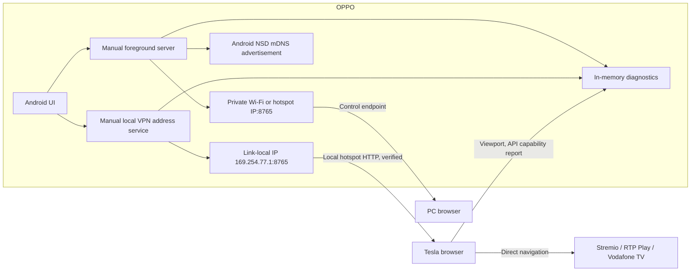

# Architecture and Phase 0 findings

## Phase 1 data flow

The Android app is a single Kotlin module. It uses `ServerSocket` and Android framework APIs, with no third-party runtime libraries. The server enumerates RFC 1918 IPv4 addresses only on Wi-Fi, hotspot-like, USB LAN, or Ethernet interfaces. It binds to each local address rather than all interfaces and rejects clients outside that address's subnet. It rescans every three seconds so a newly enabled hotspot can be used without restarting the app. Four worker threads handle short HTTP requests; connection and report sizes are bounded. The notification keeps the user-started service visible.

Version 0.1.1 removes listeners whose accept loop exits and rebinds on the next scan. A subnet-prefix change also replaces the listener, so request filtering uses the current network. A raw TCP HTTP check requests `/api/health` on each bound IP when the address changes and every 15 seconds. It verifies a Tesla Hub response on the phone, without claiming that hotspot clients can reach it. `ConnectivityManager` identifies the phone's connected Wi-Fi interfaces; other local interface candidates are preferred for the fallback URL. Diagnostic exports include private Wi-Fi link addresses/gateways, VPN presence, self-check results, and external connection counts. They do not collect Wi-Fi names, passwords, or cellular IP addresses. Phone browser reports are separate from external browser reports.

The browser page is static HTML, CSS, and JavaScript served by the phone. It reports dimensions, user agent, platform, media APIs, codecs, and storage availability to the local server. Reports are held in memory and excluded from analytics. The server accepts a small, whitelisted JSON report and does not store cookie values, localStorage values, tokens, or credentials. The diagnostic download is created in the Tesla browser and contains the displayed phone/browser state. HTTP has no encryption; local network peers can read these Phase 1 diagnostics. Android Auto video is not implemented or exposed.

Android NSD advertises `_http._tcp` under service name `teslahub`. [Android documents NSD as service discovery, with name conflict handling](https://developer.android.com/develop/connectivity/wifi/use-nsd). This does not reserve `teslahub.local`. The verified Tesla entry point is the link-local numeric URL; mDNS resolution remains unverified.

## Physical connection result and architecture constraint

The owner's version 0.1.1 test confirms a passing HTTP self-check on the OPPO and a working launcher in the phone browser. The Tesla on software **2026.32.7**, connected to the OPPO hotspot, reports `ERR_CONNECTION_REFUSED`; the Android app reports zero accepted connections from other devices during that attempt and no active VPN. This establishes phone-side operation and a failed car-to-phone connection. It does not establish the precise Tesla browser policy or routing cause.

[Homepage for Tesla's author](https://github.com/JesseWebDotCom/homepage-for-tesla/blob/main/README.md) and [Tesla CarPlay's author](https://github.com/marcraft2/tesla-carplay/blob/master/tesla-doc.md) document Tesla browser restrictions on private IP addresses, including the RFC 1918 ranges this server uses. These are third-party implementation reports, not a Tesla guarantee covering every firmware version. They make the direct-IP design an unresolved compatibility assumption. The numeric address is a test endpoint, not a proven Tesla fallback, and mDNS does not establish that a private destination will be allowed.

The subsequent PC comparison passed: the owner opened the same numeric URL on the PC and the launcher loaded with a connected-browser indicator. This verifies that the phone server accepts an external client, so a blanket OPPO incoming-access failure does not explain the Tesla result. The Tesla version is now known to be 2026.32.7. The third-party restriction reports do not establish a universal rule for every Tesla firmware version. The owner explicitly requires the launcher to remain local; public static hosting is excluded.

[TeslaMirror's current Android FAQ](https://teslamirror.com/faq-android), updated in September 2026, also documents private-LAN blocking and requires HTTPS entry points for its recent versions. This is the developer's report about its product, not an official Tesla specification or proof that the same implementation applies to 2026.32.7. No proprietary code is used. Adding TLS alone to the same private address is not a demonstrated solution to an address-access restriction. The specification protects safety restrictions, native playback, DRM/HDCP, and Android application security; it permits research into legitimate local networking. Ordinary Android VPN consent and trusted TLS can be used without changing those playback restrictions.

### Versions 0.1.2–0.1.6 — local routing feasibility test

A manually started `LocalRouteService` uses [Android's public VPN API](https://developer.android.com/develop/connectivity/vpn) to create a phone-owned local IPv4 address. The allowed-app list contains only Tesla Hub. It creates no default route, DNS override, remote gateway, always-on behavior, or media capture. It does not impersonate a globally routed public address. Android's VPN dialog supplies user consent; the app explains that Android supports one active VPN and starting this test can replace another VPN.

The version 0.1.2 PC test failed: the ordinary `10.249.177.203:8765` endpoint still returned HTTP 200, while `100.127.255.1:8765` timed out. The phone passed its virtual-address self-check and counted 11 TUN packets. Version 0.1.2 only counted and discarded those packets. The count proves that the kernel-only delivery assumption was insufficient; it did not record packet directions, so it does not establish whether the packets were incoming requests or outgoing replies.

Version 0.1.3's forwarding attempt also timed out. Header diagnostics identified IPv6 control packets (`version=6`, 48 bytes), not the PC's IPv4 TCP requests. The OPPO runs Android 14 / API 34 and `dumpsys connectivity` reports **IngressToVpnAddressFiltering: true**. No external TCP connection was accepted at the virtual address. A direct PC HTTP test without proxy settings also timed out.

[Android's ConnectivityService source](https://android.googlesource.com/platform/packages/modules/Connectivity/+/0eccf35b6b1b123996ee41e4cc078cf79c35be89/service/src/com/android/server/ConnectivityService.java) describes discarding packets addressed to an app VPN's non-link-local IP when they arrive on another interface. Link-local addresses are explicitly excluded from those discard rules. This matches the observed failure of the shared-space address. Version 0.1.4 therefore uses **`169.254.77.1/32`**, an IPv4 link-local address, for the listener and its only VPN route. It retains normal OS filtering, root-free API use, and current physical local-subnet client checks. The failed packet NAT implementation has been removed. IPv6 is allowed to use normal networks; no IPv6 capture route is added. TUN control packets are classified without being mistaken for HTTP requests. A fatal monitor error closes the route and clears the URL. Physical reachability still requires the PC test, followed by a separate Tesla test.

The route was verified on the OPPO and PC, followed by the owner's successful Tesla test described below. Local route success alone did not prove Tesla compatibility; the car screenshot supplies that evidence for the launcher on this setup. Trusted HTTPS with an owned hostname/certificate remains separate work for secure-context features if needed; the app does not contain or borrow another product's domain, certificate, private key, or code. Android Auto transport is still unimplemented.

Version 0.1.4's physical test was interrupted by a startup crash. The crash buffer showed `NoSuchMethodError` at `HubService.onCreate`: the caller still referenced the previous `LocalHttpServer` constructor, while the packaged class exposed its revised signature. JVM bytecode inspection confirmed the stale call in the build outputs. Version 0.1.5 is rebuilt with `clean`, and Kotlin incremental compilation is disabled to regenerate all callers after API changes. Compilation and JVM unit tests alone did not detect the stale Android service call; startup and service checks on the OPPO are required.

The 0.1.5 OPPO check confirmed the app stays open with the ordinary server running, passing both physical-address self-checks and without a new crash for the observed process. Version 0.1.6 also stops replacing unchanged status text every second and preserves indentation for multi-interface lists. This avoids repeated scroll relayout and keeps the manual controls usable while diagnostics refresh.

The **0.1.6 OPPO/PC test passed** on 12 October 2026: `http://169.254.77.1:8765/`, `/api/health`, `/api/state`, `/styles.css`, and `/app.js` returned HTTP 200 from the PC on the OPPO hotspot. The ordinary `10.249.177.203:8765` endpoint also responded. The app accepted the PC at `10.249.177.149`, reported no route monitor or request error, and retained both foreground services after Home and reopening. The app process stayed alive and its crash buffer contained no new crash.

The **Tesla launcher test also passed** on 12 October 2026. The owner reported it working and supplied a screenshot of the Tesla browser at `169.254.77.1:8765`, displaying the launcher, all four principal buttons, and **Local browser connected**. The previously reported firmware is **2026.32.7**. This establishes a working strictly local HTTP launcher connection on the owner's OPPO/Tesla setup, so trusted HTTPS was not necessary for that connection. It does not establish provider playback, secure-context API availability, Android Auto projection, or compatibility across every firmware version. Those remain separate tests.

## Android Auto feasibility

The leading Android-native receiver candidate is [Open Headunit (formerly Headunit Revived)](https://github.com/andreknieriem/open-headunit). It documents receiver functionality and a same-device **Self-Mode**, but that is not proof that the OPPO Find X3 Pro's current Android Auto and Google Play Services versions support it. Its README says Android Auto 17.4 changed wireless triggers and points to Android Auto's developer headunit server for Self-Mode. Phase 3 must first prove a real receiver session on the OPPO before browser video or touch work starts. No receiver code is incorporated in Phase 1.

The prospective Phase 4 path is: receiver's decoded frames → Android `MediaCodec` H.264 encoder → local transport → Tesla browser decoder → mapped touch input. [Android MediaCodec supports encoder input surfaces](https://developer.android.com/reference/android/media/MediaCodec). The browser report probes WebCodecs, WebRTC, MSE, and H.264. WebCodecs and EME generally require a secure context, so they may be unavailable at this Phase 1 `http://192.168...` origin even if the Tesla browser supports them elsewhere. [WebCodecs secure-context requirement](https://developer.mozilla.org/en-US/docs/Web/API/VideoDecoder/configure) and [EME secure-context requirement](https://developer.mozilla.org/en-US/docs/Web/API/Navigator/requestMediaKeySystemAccess) make an HTTPS or WebRTC feasibility spike necessary before selecting transport. No latency or FPS target has yet been verified.

The phone-to-Tesla Bluetooth audio plan is also unverified for media, navigation prompts, and calls. Phase 3 must test it without changing normal hands-free calling.

## Hotspot and Theater findings

[Android's local-only hotspot API](https://developer.android.com/develop/connectivity/wifi/localonlyhotspot) creates a network **without internet access**, which does not satisfy the intended Tesla-native Spotify/YouTube or web providers. Ordinary app control of the normal internet-sharing hotspot depends on privileged tethering permissions and ColorOS behavior, so Phase 1 uses user-assisted activation. No automatic hotspot claim is made.

The Stremio and RTP buttons navigate directly to the providers. [Tesla's Model 3 manual describes Theater as a parked-only surface](https://www.tesla.com/ownersmanual/model3/en_nl/GUID-79A49D40-A028-435B-A7F6-8E48846AB9E9.html). A YouTube redirect into arbitrary fullscreen content is not an official, verified interface, so Phase 1 does not depend on it. It can be tested later while parked, with direct browser navigation remaining the fallback.

The Vodafone test reported by the owner is WF052 in the Tesla browser and a black protected video area during Android mirroring. The Phase 1 API probe distinguishes missing browser features from present features, but cannot decide whether Vodafone accepts this OS, Widevine security level, HDCP, account, or license path. It never alters DRM or provider code. EME results at the local HTTP origin are especially inconclusive for Vodafone's HTTPS origin.
