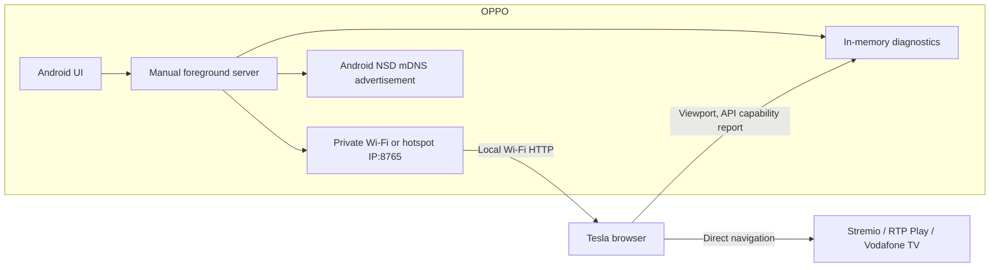

# Architecture and Phase 0 findings

## Phase 1 data flow

The Android app is a single Kotlin module. It uses `ServerSocket` and Android framework APIs, with no third-party runtime libraries. The server enumerates RFC 1918 IPv4 addresses only on Wi-Fi, hotspot-like, USB LAN, or Ethernet interfaces. It binds to each local address rather than all interfaces and rejects clients outside that address's subnet. It rescans every three seconds so a newly enabled hotspot can be used without restarting the app. Four worker threads handle short HTTP requests; connection and report sizes are bounded. The notification keeps the user-started service visible.

Version 0.1.1 removes listeners whose accept loop exits and rebinds on the next scan. A subnet-prefix change also replaces the listener, so request filtering uses the current network. A raw TCP HTTP check requests `/api/health` on each bound IP when the address changes and every 15 seconds. It verifies a Tesla Hub response on the phone, without claiming that hotspot clients can reach it. `ConnectivityManager` identifies the phone's connected Wi-Fi interfaces; other local interface candidates are preferred for the fallback URL. Diagnostic exports include private Wi-Fi link addresses/gateways, VPN presence, self-check results, and external connection counts. They do not collect Wi-Fi names, passwords, or cellular IP addresses. Phone browser reports are separate from external browser reports.

The browser page is static HTML, CSS, and JavaScript served by the phone. It reports dimensions, user agent, platform, media APIs, codecs, and storage availability to the local server. Reports are held in memory and excluded from analytics. The server accepts a small, whitelisted JSON report and does not store cookie values, localStorage values, tokens, or credentials. The diagnostic download is created in the Tesla browser and contains the displayed phone/browser state. HTTP has no encryption; local network peers can read these Phase 1 diagnostics. Android Auto video is not implemented or exposed.

Android NSD advertises `_http._tcp` under service name `teslahub`. [Android documents NSD as service discovery, with name conflict handling](https://developer.android.com/develop/connectivity/wifi/use-nsd). This does not reserve `teslahub.local`; the numeric address is the supported fallback. The interface naming heuristic and ColorOS behavior require an OPPO test.

## Android Auto feasibility

The leading Android-native receiver candidate is [Open Headunit (formerly Headunit Revived)](https://github.com/andreknieriem/open-headunit). It documents receiver functionality and a same-device **Self-Mode**, but that is not proof that the OPPO Find X3 Pro's current Android Auto and Google Play Services versions support it. Its README says Android Auto 17.4 changed wireless triggers and points to Android Auto's developer headunit server for Self-Mode. Phase 3 must first prove a real receiver session on the OPPO before browser video or touch work starts. No receiver code is incorporated in Phase 1.

The prospective Phase 4 path is: receiver's decoded frames → Android `MediaCodec` H.264 encoder → local transport → Tesla browser decoder → mapped touch input. [Android MediaCodec supports encoder input surfaces](https://developer.android.com/reference/android/media/MediaCodec). The browser report probes WebCodecs, WebRTC, MSE, and H.264. WebCodecs and EME generally require a secure context, so they may be unavailable at this Phase 1 `http://192.168...` origin even if the Tesla browser supports them elsewhere. [WebCodecs secure-context requirement](https://developer.mozilla.org/en-US/docs/Web/API/VideoDecoder/configure) and [EME secure-context requirement](https://developer.mozilla.org/en-US/docs/Web/API/Navigator/requestMediaKeySystemAccess) make an HTTPS or WebRTC feasibility spike necessary before selecting transport. No latency or FPS target has yet been verified.

The phone-to-Tesla Bluetooth audio plan is also unverified for media, navigation prompts, and calls. Phase 3 must test it without changing normal hands-free calling.

## Hotspot and Theater findings

[Android's local-only hotspot API](https://developer.android.com/develop/connectivity/wifi/localonlyhotspot) creates a network **without internet access**, which does not satisfy the intended Tesla-native Spotify/YouTube or web providers. Ordinary app control of the normal internet-sharing hotspot depends on privileged tethering permissions and ColorOS behavior, so Phase 1 uses user-assisted activation. No automatic hotspot claim is made.

The Stremio and RTP buttons navigate directly to the providers. [Tesla's Model 3 manual describes Theater as a parked-only surface](https://www.tesla.com/ownersmanual/model3/en_nl/GUID-79A49D40-A028-435B-A7F6-8E48846AB9E9.html). A YouTube redirect into arbitrary fullscreen content is not an official, verified interface, so Phase 1 does not depend on it. It can be tested later while parked, with direct browser navigation remaining the fallback.

The Vodafone test reported by the owner is WF052 in the Tesla browser and a black protected video area during Android mirroring. The Phase 1 API probe distinguishes missing browser features from present features, but cannot decide whether Vodafone accepts this OS, Widevine security level, HDCP, account, or license path. It never alters DRM or provider code. EME results at the local HTTP origin are especially inconclusive for Vodafone's HTTPS origin.
